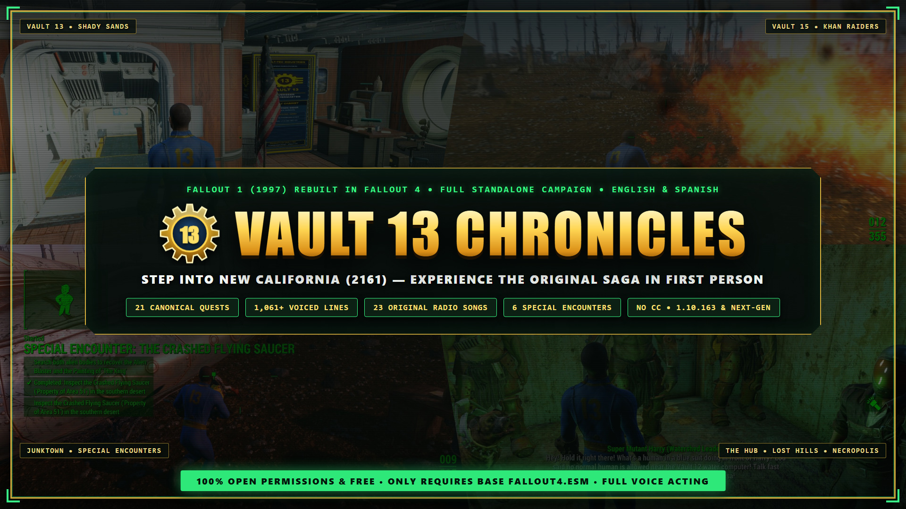
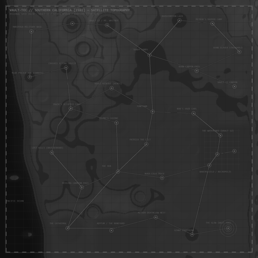
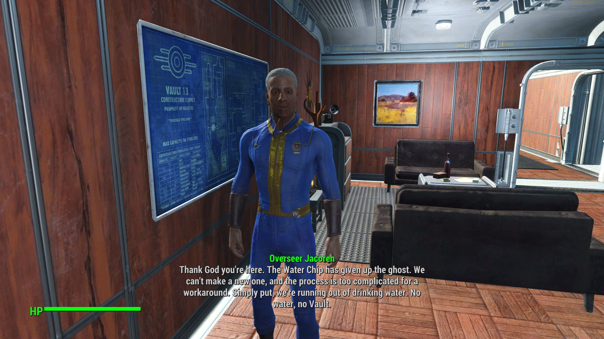
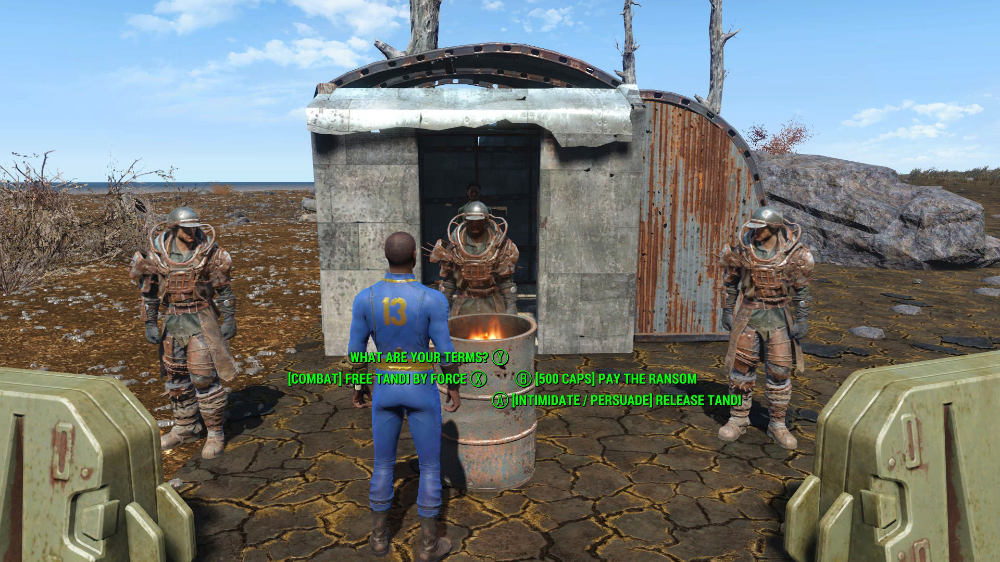
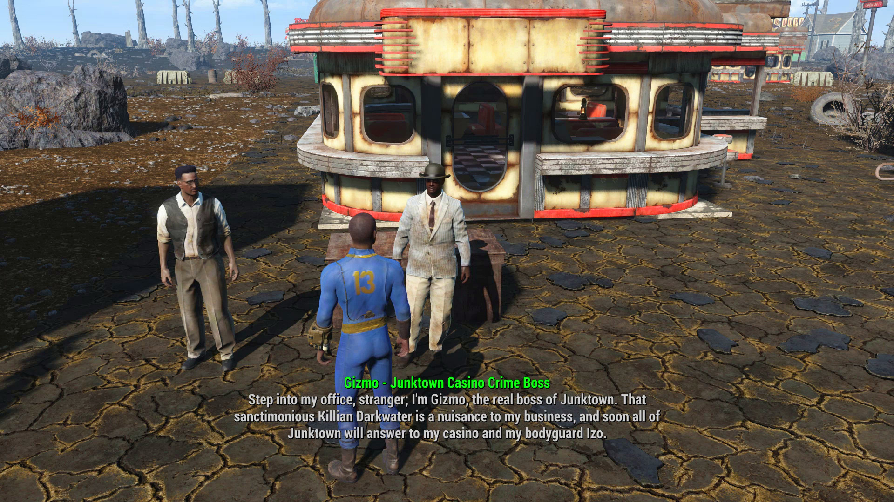
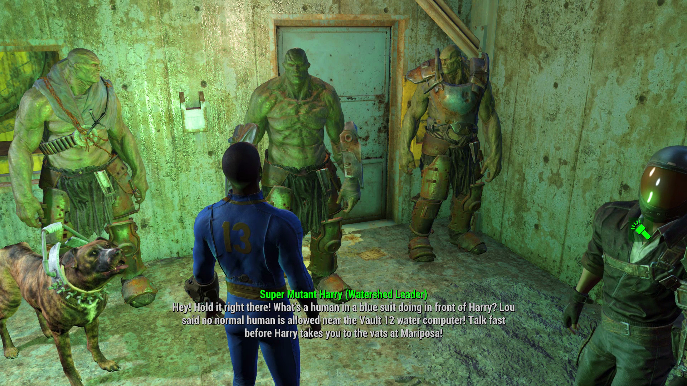
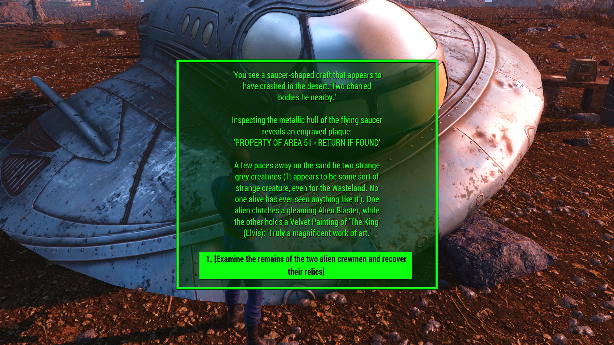
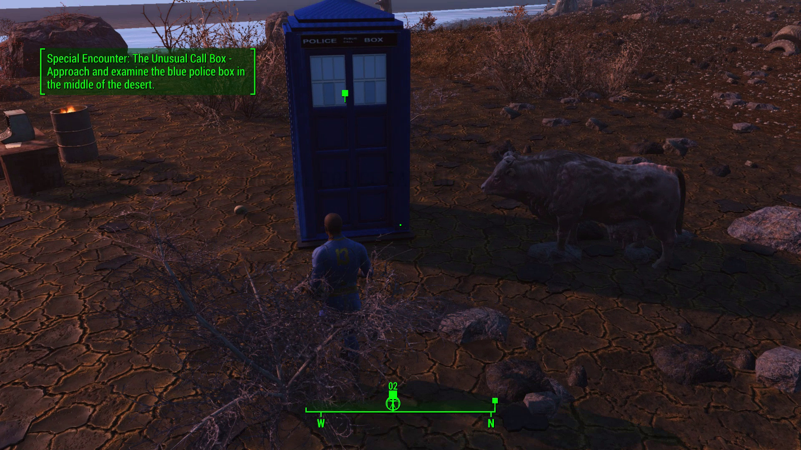
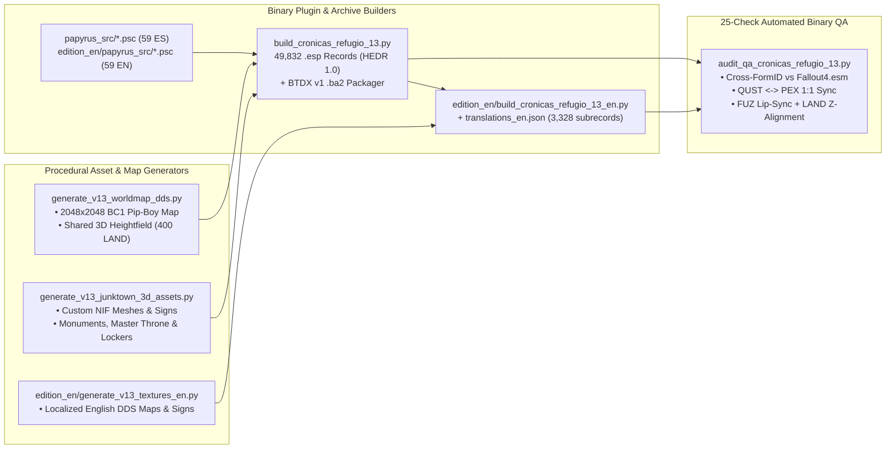
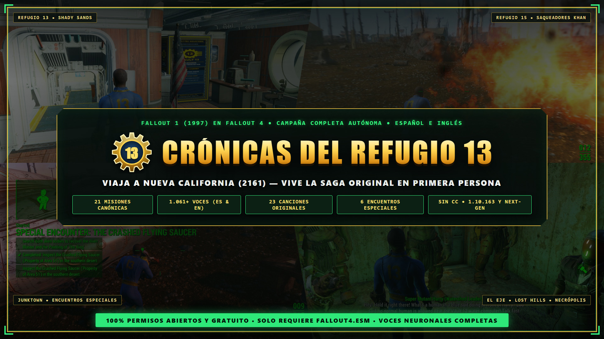

# Fallout 4 — Vault 13 Chronicles / Crónicas del Refugio 13 (2161)
### Standalone Recreation of *Fallout 1 (1997)* Inside Fallout 4 — Custom Southern California Worldspace, 1:1 Pip-Boy Map, Radio, Classic Companions & Multi-Path Quests (English & Spanish Editions)

[](LICENSE)
[](https://www.nexusmods.com/fallout4/mods/111327)
[](https://youtu.be/f4HKP1jbSHs)
[](#universal-compatibility)
[](#universal-compatibility)
[](ROADMAP.md)



> **🌍 Language Navigation & Direct Downloads / Navegación y Descarga Directa:**
> - 🎬 **[Watch Official Trailer on YouTube / Ver Tráiler Oficial en YouTube (`youtu.be/f4HKP1jbSHs`)](https://youtu.be/f4HKP1jbSHs)**
> - 🧡 **[Nexus Mods Unified Page (EN & ES Main Files — `#111327`)](https://www.nexusmods.com/fallout4/mods/111327)**
> - 🇺🇸 **[English Documentation (Features, Pip-Boy Worldspace, Status & Installation)](#english-documentation)**
> - 🇪🇸 **[Documentación en Español (Aportaciones Clave, Estado Actual, Hoja de Ruta e Instalación)](#documentación-en-español)**
> - 📦 **[Download Complete Playable `.zip` Packages (EN & ES) — `v1.0.0 Complete Edition`](https://github.com/0utKast/fallout4-vault13-chronicles/releases)**
>   - 🇺🇸 `Vault13Chronicles_EN_v1.0.0.zip` *(100% Pure English Edition — Ready for Vortex / MO2 / Manual)*
>   - 🇪🇸 `CronicasDelRefugio13_ES_v1.0.0.zip` *(Edición 100% en Español — Lista para Vortex / MO2 / Manual)*
> - 🗺️ **[Detailed Engineering Roadmap (`ROADMAP.md`)](ROADMAP.md)** · 📜 **[1997 Lore Bible (`CANON_FALLOUT_1_1997.md`)](CANON_FALLOUT_1_1997.md)** · ⚖️ **[Credits & Open Permissions (`CREDITS.md`)](CREDITS.md)**

---

<a name="english-documentation"></a>
# 🇺🇸 English Documentation

## 1. Overview
**Vault 13 Chronicles (2161)** is a **100% standalone, dependency-free recreation of Interplay's *Fallout: A Post Nuclear Role Playing Game (1997)* built directly inside the Fallout 4 engine**.

Discover the **Vault-Tec Mnemosyne Historical Archive** in the Commonwealth (northwest of Vault 111 / Sanctuary Hills) and step through the **Temporal Bridge** back to **December 5, 2161** as the original **Vault Dweller**—with just **150 days of water** remaining for Vault 13. Travel freely across a custom-engineered **Southern California open worldspace**, navigate directly on your **Pip-Boy 3000 tactical world map**, tune in to **The Hub Radio (84.5 kHz)**, recruit all **4 classic squad companions** (**Ian**, **Desert Ranger Tycho**, **Katja**, and **Dogmeat**), resolve branching 1997 free-order RPG quests from **The Water Chip** through **Mariposa Military Base**, **The Cathedral**, and **May 10, 2162 Exile**, and return to 2287 Commonwealth whenever you wish with every classic weapon and relic you unlock.

---

## 2. Key Technical & Gameplay Contributions

| Pillar | What Makes *Vault 13 Chronicles* Unique |
| :--- | :--- |
| 🗺️ **Custom Open Worldspace 100% Trackable on the Pip-Boy** | Hand-engineered **`20×20` exterior cell worldspace (`WRLD 0x01003400`, `400` `LAND` heightmap & vertex-normal cells, `81,920 × 81,920` units)** sculpting the Pacific coastline (Monterey to Santa Monica), Sierra Nevada passes, Central Valley, and Mojave wasteland, paired 1:1 with a **custom `2048×2048` BC1 Pip-Boy World Map** (`32` discoverable `MapMarkers`, real-time player cursor, quest markers & fast travel) and `40` custom 3D `.nif` structures & monuments. |
| 📻 **Dedicated 2161 Radio Station (*The Hub Radio 84.5 kHz*)** | Features **41 original atomic-age songs**, **18 commercial jingles**, and **8 serialized radio dramas** interleaved with **110 reactive voiced DJ news broadcasts** reacting dynamically to the events of 2161. Era-aware scripting (`V13RadioQuestScript.psc`) automatically tunes in upon entering 2161, suppresses anachronistic 2287 Commonwealth stations while in California, and restores your exact 2287 radio settings when you return! |
| 🤝 **All 4 Simultaneous Classic Squad Companions** | Recruit **Ian** (Shady Sands, Colt 6520 10mm Pistol), **Desert Ranger Tycho** (Junktown, Combat Shotgun & Ranger gear), **Katja** (The Boneyard, `.45` SMG & lockpicks), and **Dogmeat 2161** (distinct Raider Dog breed & leather harness)—and **travel with all four simultaneously** across exterior wasteland and interior dungeons using dedicated tactical command menus. |
| 🎭 **True 1997 Multi-Path Free-Order Campaign & Side Quests** | Full **5-Act Campaign** honorably following *Fallout 1*'s free-order endgame (`1997` canon): **Tandi** (4 paths), **Gizmo** (3 ways), **Necropolis Watershed** (Harry, Barry & Sally + Great Water Pump moral pact), **Lost Hills** & **ZAX 1.2** chess/lore, **Honor of Steel (T-51b)**, **Adytum Civil War** & **Forge of Adytum**, **Followers' Spy**, **Mariposa** (Cathedral disguise, forcefields, The Lieutenant), **The Cathedral** (3 Master victory paths incl. Vree's Autopsy proof & Tri-Voice speech), **May 10, 2162 Exile**, plus **dynamic Mutant Invasion calendar** & **5 Desert Encounters**. |
| 🛸 **All 6 Classic 1997 Special Encounters (6/6)** | **1.** 1960s British Police Box (**TARDIS** + working **Pip-Boy Motion Sensor**!), **2.** Overturned **Nuka-Cola Truck** (`1000 + Luck × 976` caps), **3.** Area 51 **Crashed UFO** (**Alien Blaster** + custom 3D **Elvis Velvet Painting**), **4.** **Giant Godzilla Footprint** (**Stealth Boy 3001**), **5.** **Bob's Pre-Owned Car Mart** (**Red Ryder LE BB Gun**), and **6.** **Patrick the Celt** (voiced campfire encounter, Gaelic ballad *Na Fianna* & **+1 Permanent Charisma**). |
| 🎙️ **Two 100% Standalone Voiced Editions (EN + ES)** | Every single asset is localized natively in two separate builds: **`1,544` Lip-Sync `.fuz` dialogue clips** (`1,592` `.fuz` files packaged in `Main.ba2`), localized `2048×2048` Pip-Boy maps, localized 3D world signs & quartermaster lockers, `78` 4-option dialogue wheels (`SCEN`), and `3,328` translated public-release plugin subrecords (`3,403` incl. QA mode). |
| 🛠️ **Programmatic Binary Compiler & 25-Check QA Suite** | Built reproducibly from Python (`build_cronicas_refugio_13.py`: `49,832` custom `.esp` records, `28` quests, `59` Papyrus `.psc`/`.pex` state machines, procedural `.nif`/`.dds` generators) and verified by `audit_qa_cronicas_refugio_13.py` (**`24/24` ES & `25/25` EN checks passed, `0` warnings, `0` errors**). |

### Custom `2048×2048` Calibrated Pip-Boy Tactical Maps (English & Spanish Editions)
| 🇺🇸 English Pip-Boy Tactical Map (`edition_en/`) | 🇪🇸 Spanish Pip-Boy Tactical Map (`assets/`) |
| :---: | :---: |
|  |  |

---

## 3. Complete `v1.0.0` Scope: Chapters 1 & 2 (100% Implemented & QA Verified)

We believe in **100% engineering transparency** for players and fellow modders. Below is the exact breakdown of everything **completed, voiced (EN + ES), QA-verified (`24/24` ES, `25/25` EN), and playable in `v1.0.0 Complete Edition`**:

| Module / Region | Status | Details |
| :--- | :---: | :--- |
| **Prologue & Mnemosyne Temporal Bridge (`2287 ↔ 2161`)** | ✅ **100% Done** | Bunker NW of Vault 111, Memory Pod, Relic Hall & unrestricted two-way travel keeping all classic loot. |
| **Vault 13 Hub & Internal Subplots (`CELL 0x01002100`, `0x01002200`)** | ✅ **100% Done** | Overseer Jacoren, Lyle, Calvin, Cindy, Medical Officer, Scout Ed's corpse, Theresa's rebel faction & water theft investigation. |
| **Southern California Open Worldspace & Pip-Boy Map (`WRLD 0x01003400`)** | ✅ **100% Done** | `400` exterior `LAND` cells (`20×20`), `32` `MapMarkers`, EN & ES `2048×2048` Pip-Boy maps, fast travel, quest markers & `11` custom 3D monuments. |
| **The Hub Radio (`84.5 kHz`)** | ✅ **100% Done** | `41` atomic-age songs, `18` jingles & `8` radio dramas + `110` reactive voiced DJ broadcasts (EN & ES) + automatic 2161/2287 radio switching. |
| **Shady Sands, Northern Khans & Act I: Vault 15 Ruins** | ✅ **100% Done** | Aradesh, Razlo's Radscorpion antidote for Jarvis, Diana & Gwen, **4-way Tandi Rescue**, Garl Death-Hand & Vault 15 rockslide holotape. |
| **Junktown (Killian, Gizmo, The Skulz & Doc Morbid)** | ✅ **100% Done** | Hitman Kenji, 3-way Gizmo taped confession, Neal's urn & Vinnie's Skulz, Doc Morbid's clinic & *Iguana Bob* cooler secret. |
| **The Hub (Irwin's Farm, Water Merchants, Caravans & Decker)** | ✅ **100% Done** | **.223 Pistol ("That Gun")**, Harold, Butch Harris, Martha Rastello's water caravan contract, Missing Caravans Deathclaw & Tug, Sheriff Greene vs. Decker & Kane. |
| **Act II: Necropolis, Underground, Watershed & Vault 12 Finale** | ✅ **100% Done** | Set & Garret, Underground ghouls & Ezekiel, Great Water Pump moral pact, Super Mutants **Harry, Barry & Sally** + Ghoul Prisoner, **Vault 12 Water Chip** extraction & Vault 13 restoration! |
| **Frontier & Boneyard Quests (The Glow, Honor of Steel, Adytum, Followers)** | ✅ **100% Done** | Cabbot, Paladin Talus & Sgt. Allen's holodisk (**Wattz 2000**); **Honor of Steel** (Knight Kyle, Michael, Rhombus, Lorenzo, **T-51b**); **Adytum Civil War** (Zimmerman/Regulators vs. Razor/Blades & Gun Runners); **Forge of Adytum** (Miles & Smitty: **Winchester P94 Turbo** & **Hardened T-51b**); **Followers' Spy** (Nicole, Talius & Heather). |
| **All 4 Classic Companions: *Ian*, *Tycho*, *Katja* & *Dogmeat 2161*** | ✅ **100% Done** | Simultaneous 4-companion squad travel with authentic loadouts and tactical command menus. |
| **All 6 Classic Special Encounters + 5 Desert Encounters & Invasions** | ✅ **100% Done** | TARDIS (+ Motion Sensor), Area 51 UFO (+ Alien Blaster & Elvis Painting), Nuka-Cola Truck, Giant Footprint, Bob's Car Mart (+ Red Ryder LE), Patrick the Celt (+1 CHR), **5 Wasteland Encounters** & **1997 Mutant Invasion calendar**. |
| **Act III Interior: Multi-Level Lost Hills & Subterranean West Tek (`ZAX 1.2`)** | ✅ **100% Done** | 4-level Brotherhood Bunker with John Maxson, Rhombus, **Head Scribe Vree's Autopsy Holodisk**, plus full subterranean West Tek facility featuring interactive **ZAX 1.2** chess & FEV lore dialogue. |
| **Act IV: Mariposa Military Base & The Lieutenant ("Lou")** | ✅ **100% Done** | Multi-path infiltration (Cathedral purple robe disguise, patrol radio/science/explosives forcefield emitters, Nightkin, voiced **Lieutenant** showdown & 180s Vats self-destruct escape). |
| **Act V: The Cathedral, The Master (3 Paths) & May 10, 2162 Exile** | ✅ **100% Done** | **Sister Laura** ("Red Rose"), **Father Lasher**, **Morpheus**, **Gideon** & **Psychic Nullifier**, **3 canonical Master victory paths** with Tri-Voice synthesis (`V13TheMasterTriVoice`: Vree's Autopsy proof, Combat, or Sublevel IV 240s Nuke) & playable **May 10, 2162 Exile** + Arroyo Camp. |

*(See [`ROADMAP.md`](ROADMAP.md) and [`INFORME_CAPITULO_1_HOJA_DE_RUTA.md`](INFORME_CAPITULO_1_HOJA_DE_RUTA.md) for FormID-level checklists).*

---

## 4. In-Game Screenshot Showcase (`1920×1080`)

| Vault 13 Overseer Jacoren Briefing | 4-Way RPG Choice: Rescuing Tandi |
| :---: | :---: |
|  |  |
| **Junktown: Confronting Crime Boss Gizmo & Izo** | **Necropolis Watershed: Super Mutant Harry** |
|  |  |
| **Special Encounter: Area 51 Crashed UFO & Elvis** | **Special Encounter: 1960s TARDIS & Motion Sensor** |
|  |  |

*(Browse all 20 full-resolution screenshots in [`NEXUS_MEDIA_PACK/02_20_CAPTURAS_GALERIA_1920x1080/`](NEXUS_MEDIA_PACK/02_20_CAPTURAS_GALERIA_1920x1080/)).*

---

<a name="universal-compatibility"></a>
## 5. Universal Compatibility & Open Modding Stance
- **Natively Compatible Out-of-the-Box With:**
  - **Fallout 4 `1.10.163`** *(Pre-Next-Gen / GOG / Downgraded)*
  - **Fallout 4 `1.10.980+`** *(Next-Gen / Anniversary Edition)*
- **Binary Engineering Standards:**
  - Plugin Header: **`HEDR v1.00`** with 100% of custom FormIDs allocated at `>= 0x01000800`.
  - Archives: **`BTDX Version 1`** (`GNRL v1` & `DX10 v1` — never `v7/v8`, so no backport patchers are needed on `1.10.163`).
- **Zero Lock-In:** Requires **only `Fallout4.esm`**. **Zero** Creation Club content, **zero** DLCs, **zero** F4SE/DLLs, and **zero** third-party mod dependencies. Released under **100% Open Permissions (MIT)**.

---

## 6. Installation & How to Start In-Game

> [!IMPORTANT]
> **Save Compatibility Notice (`v0.9.x` → `v1.0.0`):** `v1.0.0 Complete Edition` rebuilds Southern California 6.25× (`64 → 400` exterior cells), relocates hubs, and reassigns persistent FormIDs. It is **NOT compatible with `v0.9.x` Beta savegames** — please start `v1.0.0` on a new game or a clean Fallout 4 save that has **never** loaded `v0.9.x`. Players finishing an ongoing Beta campaign can keep using **`v0.9.3` in Nexus Mods "Old Files" (`#111327`)** or on the **[`release/v0.9.x`](https://github.com/0utKast/fallout4-vault13-chronicles/tree/release/v0.9.x) GitHub branch**.

1. **Download Your Preferred Standalone Edition** from **[Nexus Mods (`#111327`)](https://www.nexusmods.com/fallout4/mods/111327)** or **[GitHub Releases](https://github.com/0utKast/fallout4-vault13-chronicles/releases)**:
   - **English Edition:** `Vault13Chronicles_EN_v1.0.0.zip`
   - **Spanish Edition:** `CronicasDelRefugio13_ES_v1.0.0.zip`
2. **Install via Mod Manager or Manually:**
   - **Vortex / Mod Organizer 2 (Recommended):** Install the `.zip` archive directly and enable `Vault13Chronicles.esp`.
   - **Manual:** Extract `Vault13Chronicles.esp`, `Vault13Chronicles - Main.ba2`, and `Vault13Chronicles - Textures.ba2` into your `Fallout 4\Data` directory and enable `*Vault13Chronicles.esp`.
3. **Start Your Journey:**
   - Load any clean save without `v0.9.x` history (or start a new game). Your Pip-Boy automatically marks the **Vault-Tec Mnemosyne Historical Archive** bunker in the Commonwealth (northwest of Vault 111 / Sanctuary Hills).
   - Enter the bunker and activate the **Neural Simulation Mainframe** beside the Memory Pod to cross into **Vault 13 (December 5, 2161)**.

---

## 7. Architecture, Repository Layout & Reproducible Build Pipeline



### Repository Structure
- [`build_cronicas_refugio_13.py`](build_cronicas_refugio_13.py) — Primary binary `.esp` (`49,832` custom records) and `.ba2` (`v1`) compiler for the Spanish base build.
- [`generate_v13_worldmap_dds.py`](generate_v13_worldmap_dds.py) — Generates the `2048×2048` BC1 Pip-Boy tactical map and defines `global_california_height(wx, wy)` across all `400` (`20×20`) exterior `LAND` cells.
- [`generate_v13_junktown_3d_assets.py`](generate_v13_junktown_3d_assets.py) & [`v13_opt_helpers.py`](v13_opt_helpers.py) — Procedural 3D `.nif` mesh, `.bgsm` material, and `BC1` mipmapped `.dds` texture generators (`40` `.nif`, `45` `.bgsm`/`.bgem`, `47` `.dds` across the build).
- [`papyrus_src/`](papyrus_src/) & [`papyrus_out/`](papyrus_out/) — All `59` Papyrus quest, companion, radio, creature AI, weapon effect, and terminal state-machine scripts (`.psc` & compiled `.pex`).
- [`edition_en/`](edition_en/) — Complete standalone English localization pipeline (`translations_en.json`, `generate_v13_textures_en.py`, `sync_papyrus_en.py`, `synthesize_voices_and_radio_en.py`, `build_cronicas_refugio_13_en.py`, `papyrus_src/`, and `build_out/`).
- [`audit_qa_cronicas_refugio_13.py`](audit_qa_cronicas_refugio_13.py) & [`verify_v13_mod.py`](verify_v13_mod.py) — 6-module (`24/24` ES, `25/25` EN) binary integrity, quest/Papyrus sync, `.fuz` Lip-Sync, terrain Z-alignment, and `.ba2` asset chain audit suite.
- [`radio_music/`](radio_music/) — Original vintage atomic-age soundtrack tracks for *The Hub Radio / Radio El Eje (84.5 kHz)*.
- [`CANON_FALLOUT_1_1997.md`](CANON_FALLOUT_1_1997.md), [`ROADMAP.md`](ROADMAP.md), [`INFORME_CAPITULO_1_HOJA_DE_RUTA.md`](INFORME_CAPITULO_1_HOJA_DE_RUTA.md) — Historical 1997 canon bible and engineering roadmaps.
- [`NEXUS_MEDIA_PACK/`](NEXUS_MEDIA_PACK/) — Official banners (`1920×1080` & `1400×400`) and `20` full-HD gameplay screenshots.

### Running the Automated QA Suite
```powershell
# Audit Spanish build (24/24 checks)
python audit_qa_cronicas_refugio_13.py

# Audit English build including full localization verification (25/25 checks)
python audit_qa_cronicas_refugio_13.py --en
```

---
---

<a name="documentación-en-español"></a>
# 🇪🇸 Documentación en Español



## 1. Descripción General
**Crónicas del Refugio 13 (2161)** es una **recreación autónoma y sin dependencias externas del mítico *Fallout: A Post Nuclear Role Playing Game (1997)* construida íntegramente dentro del motor de Fallout 4**.

Adéntrate en el **Archivo Histórico Mnemosyne de Vault-Tec** en la Commonwealth (al noroeste del Refugio 111 / Sanctuary Hills) y cruza el **Puente Temporal** hasta el **5 de diciembre de 2161** en la piel del **Morador del Refugio** original, cuando el Chip Controlador de Agua acaba de quemarse y solo quedan **150 días de reservas potables**. Recorre libremente un **mundo exterior de elaboración propia (Sur de California 2161)** perfectamente seguible desde el **mapa táctico de tu Pip-Boy**, sintoniza **Radio El Eje (84.5 kHz)**, viaja acompañado por los **4 compañeros clásicos simultáneos** (**Ian**, **el Ranger Tycho**, **Katja** y **Albóndiga**), resuelve toda la campaña original de 1997 en **orden libre** hasta el **Exilio del 10 de mayo de 2162** y regresa a la Commonwealth de 2287 cuando quieras conservando todas las armas y reliquias clásicas desbloqueadas.

---

## 2. Aportaciones Clave e Innovaciones Técnicas del Proyecto

1. **🗺️ Mundo Exterior Propio («Sur de California 2161») 100% Seguible desde el Pip-Boy (`WRLD 0x01003400`):**
   - **400 celdas exteriores de terreno `LAND` (`20×20`, `81.920 × 81.920` unidades)** esculpidas por código reproduciendo la costa del Pacífico californiano, los pasos de Sierra Nevada, el Valle Central y el desierto del Mojave, junto a **`40` modelos y estructuras 3D propias (`.nif`)** (*Trono del Maestro*, Catedral gótica, búnker de Lost Hills, fachada de Mariposa, murallas de Shady Sands, etc.).
   - **Mapa Táctico `2048×2048` BC1 integrado en el Pip-Boy (`V13CaliforniaWorldMap_d.dds`)** proyectado 1:1 sobre las coordenadas reales del mundo (con ediciones dedicadas en español e inglés), **`32` marcadores de mapa descubribles**, seguimiento de la posición del jugador en tiempo real, objetivos de misión y viaje rápido.
2. **📻 Emisora Propia de 2161 — *Radio El Eje / The Hub Radio (84.5 kHz)* (`V13RadioQuestScript.psc`):**
   - Incluye **41 canciones originales de estética años 40/50 de la era atómica**, **18 cuñas publicitarias**, **8 radionovelas** y **110 boletines informativos reactivos doblados** (en español en la edición ES y en inglés en la edición EN) que narran las consecuencias de tus actos en Nueva California en 2161.
   - **Conmutación temporal inteligente:** Al cruzar a 2161 sintoniza la radio de Nueva California y silencia las emisoras anacrónicas de 2287 (Diamond City Radio, Radio Libertad, etc.), restaurando automáticamente tu configuración original al volver a la Commonwealth.
3. **🤝 Escuadrón con los 4 Compañeros Clásicos Simultáneos (*Ian*, *Ranger Tycho*, *Katja* y *Albóndiga 2161*):**
   - Recluta a **Ian** en Shady Sands (con su clásica **Colt 6520 de 10 mm**), al **Ranger del Desierto Tycho** en Junktown (con su **Escopeta de Combate** y armadura de Ranger), a **Katja** en El Boneyard (con su subfusil del `.45`, cuchillos y ganzúas) y a **Albóndiga 2161** (con su aspecto clásico de Perro de Presa y arnés de cuero con correas, distinto del Pastor Alemán de Fallout 4).
   - **Viaja con los cuatro a la vez** tanto por el desierto de California como por todos los interiores del mod, gestionándolos mediante menús tácticos propios.
4. **🎭 Campaña Completa en Orden Libre (1997), Invasiones Dinámicas y Misiones Multi-Vía:**
   - **Capítulo 1 (El Chip de Agua):** Rescate de **Tandi** por 4 vías, Refugio 15, **Gizmo** por 3 vías, **Neal y Los Cráneos**, **Doc Morbid**, **Granja de Irwin** (**Pistola del .223**), **Mercaderes del Agua**, **Caravanas Desaparecidas**, **Sheriff Greene frente a Decker**, y **Necrópolis / Cuenca / Refugio 12** (**Gran Bomba de Agua**, **Harry, Barry y Sally**).
   - **Capítulo 2 (El Ejército Mutante, El Maestro y el Exilio):** Interior multinivel de **Lost Hills** (John Maxson, Rhombus, **Holocinta de Autopsia de Vree**), complejo subterráneo de **El Resplandor / West Tek** (**ZAX 1.2** interactivo), **Honor de Acero (T-51b)**, **Guerra Civil y Forja de Adytum** (**Winchester P94 Turbo** y **T-51b Endurecida**), **Espía de los Seguidores** (**Nicole**, **Talius**, **Heather**), **Mariposa** (túnica púrpura, campos de fuerza, **El Teniente «Lou»** y autodestrucción), **La Catedral** (**Hermana Laura**, **Padre Lasher**, **Morpheus**, **Gideon**, **Anulador Psíquico** y las **3 vías frente al Maestro** con síntesis multivoz `V13TheMasterTriVoice`), **Epílogo jugable del Exilio (10 de mayo de 2162)**, **calendario cronológico de invasiones supermutantes** y **5 Encuentros del Yermo**.
5. **🛸 Los 6 Encuentros Especiales Míticos de *Fallout 1* (6 de 6 Implementados):**
   - **Cabina Policial Británica TARDIS** (otorga un **Sensor de Movimiento** funcional para el Pip-Boy), **OVNI Estrellado del Área 51** (**Bláster Alienígena** + **Cuadro 3D en Terciopelo de Elvis «El Rey»**), **Camión de Nuka-Cola Volcado** (`1000 + Suerte × 976` chapas), **La Huella Gigante de Godzilla** (**RobCo Stealth Boy 3001**), **Concesionario de Coches de Bob** (**Red Ryder LE BB Gun**) y **Patrick el Celta** (rueda de diálogo doblada junto a la hoguera, balada gaélica *Na Fianna* y **+1 Carisma permanente**).
6. **🛠️ Ingeniería Binaria Reproducible, Doblaje Lip-Sync Completo y Auditoría QA Automatizada:**
   - Dos ediciones autónomas 100% independientes (Español e Inglés) con **`1.544` clips de voz Lip-Sync `.fuz`** referenciados por diálogo (`1.592` `.fuz` y `1.936` archivos en `Main.ba2`), `49.832` registros propios en `Vault13Chronicles.esp`, `28` misiones, `59` scripts Papyrus compilados, `78` ruedas de diálogo interactivas (`SCEN`), `40` modelos 3D `.nif`, `45` materiales `.bgsm/.bgem` y `47` texturas `BC1`, verificados al 100% por `audit_qa_cronicas_refugio_13.py` (**`24/24` checks ES y `25/25` checks EN superados con `0` advertencias y `0` errores**).

---

## 3. Alcance Completo en `v1.0.0` (*Capítulos 1 y 2 Completos*)

Todo el arco histórico de *Fallout 1 (1997)* está implementado, doblado y verificado sin elementos pendientes:

### ✅ COMPLETADO Y 100% JUGABLE EN `v1.0.0 Complete Edition` (*Capítulos 1 y 2*)
- **Prólogo y Puente Temporal (`2287 ↔ 2161`)**: Búnker del Archivo Mnemosyne al noroeste del Refugio 111 con viaje libre de ida y vuelta y Sala de Reliquias.
- **Refugio 13 completo**: Supervisor Jacoren, residentes doblados, cueva de salida con el cadáver de Ed, rebelión interna de Theresa e investigación del robo de agua.
- **Mundo exterior «Sur de California (2161)» expandido**: `400` celdas exteriores (`20×20`, `81.920 × 81.920` unidades), mapa táctico `2048×2048` en el Pip-Boy (ES y EN), `32` ubicaciones con marcador, `40` activos 3D `.nif` y viaje rápido.
- **Radio El Eje (`84.5 kHz`) completa**: `41` canciones, `18` cuñas publicitarias, `8` radionovelas y `110` boletines reactivos doblados en español e inglés.
- **Actos I y II completos**: Shady Sands, Refugio 15 (Garl Mano Muerta), Junktown (Killian, Kenji, Gizmo, Skulz, Doc Morbid), El Eje (Irwin, Harold, Butch, Mercaderes del Agua, Caravanas Desaparecidas, Greene vs. Decker), Necrópolis (Set, Subterráneos, Gran Bomba de Agua, Harry/Barry/Sally, Refugio 12) y restauración del Refugio 13.
- **Acto III completo (Interior de Lost Hills e Interior de El Resplandor / West Tek)**: Búnker multinivel de la Hermandad (**John Maxson**, **Rhombus**, **Escriba Jefe Vree** con su **Holocinta de Autopsia**, **Caballero Kyle**, **Michael**, **Lorenzo** y T-51b) + complejo subterráneo de **West Tek** con **ZAX 1.2** interactivo y partida de ajedrez.
- **Misiones de El Boneyard y Cuarto Compañero (*Katja*)**: Guerra civil en Adytum (**Jon Zimmerman**, **Caleb** vs. **Razor**, **Gabriel**), Forja de Adytum (**Miles** y **Smitty**: **Winchester P94 Turbo** y **T-51b Endurecida**), Espía de los Seguidores (**Nicole**, **Talius**, **Heather**) y reclutamiento de **Katja** para viajar con los 4 compañeros clásicos a la vez.
- **Actos IV y V en Orden Libre (Mariposa, La Catedral, El Maestro y Exilio 2162)**: Infiltración en **Mariposa** (túnica púrpura, campos de fuerza, Nocturnos, **El Teniente «Lou»** y autodestrucción en 180 s); infiltración en **La Catedral** (**Hermana Laura**, **Padre Lasher**, **Morpheus**, **Gideon** y **Anulador Psíquico**); las **3 vías canónicas frente al Maestro** con voz triple (`V13TheMasterTriVoice`) —Autopsia de Vree, combate directo u ojiva nuclear en 240 s—; **Epílogo del Exilio (10 de mayo de 2162)** junto a Jacoren y campamento de Arroyo (**Theresa** y **Lyle**).
- **Los 6 Encuentros Especiales (6/6), 5 Encuentros del Yermo e Invasiones Mutantes (1997)** con doble edición autónoma (ES + EN) auditada con `0` errores y `0` advertencias.

---

## 4. Compatibilidad Universal (`1.10.163` + Next-Gen/AE) e Instalación

> [!IMPORTANT]
> **Aviso sobre partidas guardadas de la Beta `v0.9.x`:** La Edición Completa `v1.0.0` amplía el mundo exterior 6,25× (`64 → 400` celdas), reubica asentamientos y reasigna FormIDs persistentes, por lo que **NO es compatible con partidas que ya hayan usado la Beta `v0.9.0–v0.9.3`**. Inicia una partida nueva o carga un guardado limpio de Fallout 4 donde **nunca** se haya activado la `v0.9.x`. Si quieres terminar antes tu campaña anterior, **`v0.9.3` sigue disponible en «Old Files» de Nexus Mods (`#111327`)** y en la rama **[`release/v0.9.x`](https://github.com/0utKast/fallout4-vault13-chronicles/tree/release/v0.9.x)** de GitHub.

- **Compatibilidad Nativa Universal:** Funciona directamente y sin parches tanto en **Fallout 4 `1.10.163` (Pre-Next-Gen / GOG / Downgraded)** como en **`1.10.980+` (Next-Gen / Anniversary Edition)** gracias a su cabecera **`HEDR v1.00`** (`FormIDs >= 0x800`) y archivos **`.ba2` Versión 1** (`GNRL v1` y `DX10 v1`).
- **Cero Dependencias y Política Abierta:** Solo requiere `Fallout4.esm` (**0** Creation Club, **0** DLCs, **0** F4SE y **0** mods externos). Publicado bajo **Permisos 100% Abiertos (Licencia MIT)**, rechazando cualquier sistema de bloqueo o privatización del *modding*.
- **Instalación Rápida:**
  1. Descarga la edición que prefieras desde **[Nexus Mods (`#111327`)](https://www.nexusmods.com/fallout4/mods/111327)** o **[GitHub Releases](https://github.com/0utKast/fallout4-vault13-chronicles/releases)** (`CronicasDelRefugio13_ES_v1.0.0.zip` en español o `Vault13Chronicles_EN_v1.0.0.zip` en inglés) — y mira el **[Tráiler Oficial en YouTube](https://youtu.be/f4HKP1jbSHs)**.
  2. Instálalo con **Vortex / Mod Organizer 2** o extrae `Vault13Chronicles.esp`, `Vault13Chronicles - Main.ba2` y `Vault13Chronicles - Textures.ba2` en `Fallout 4\Data` y activa `Vault13Chronicles.esp`.
  3. Carga una partida limpia (sin historial de la `v0.9.x`) tras salir del Refugio 111 y dirígete al marcador del **Archivo Histórico Mnemosyne de Vault-Tec** (al noroeste del Refugio 111) para viajar al **Refugio 13 (5 de diciembre de 2161)**.

---

## 📜 Credits & License / Créditos y Licencia
- **Author / Autor:** **OutKast (`0utKast`)** — [GitHub Profile](https://github.com/0utKast)
- **License / Licencia:** **[MIT License & 100% Open Modding Permissions](LICENSE)** — Free to use, study, modify, translate, and redistribute with attribution. See **[`CREDITS.md`](CREDITS.md)** for complete acknowledgments to **Interplay Productions** (*Fallout*, 1997) and **Bethesda Game Studios** (*Fallout 4*).
