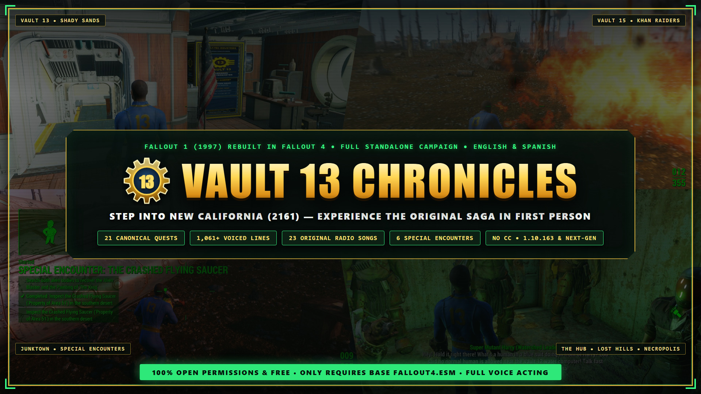
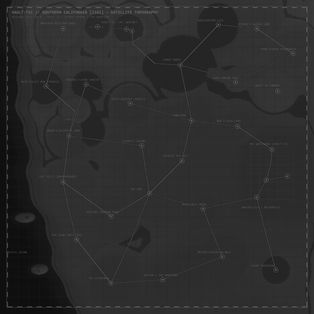
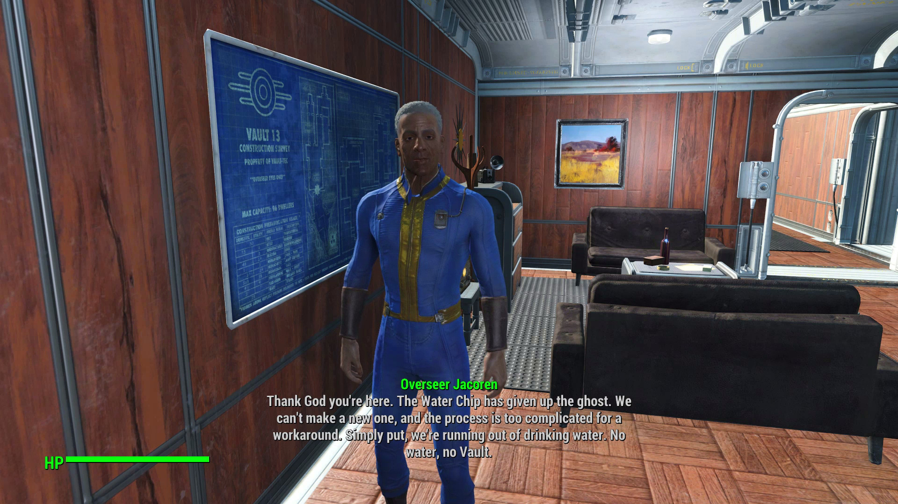
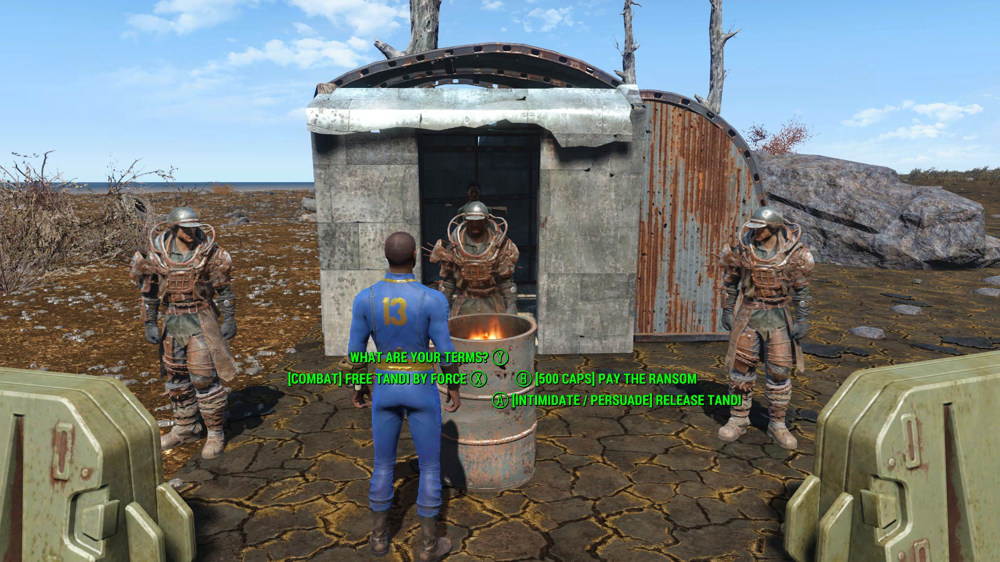
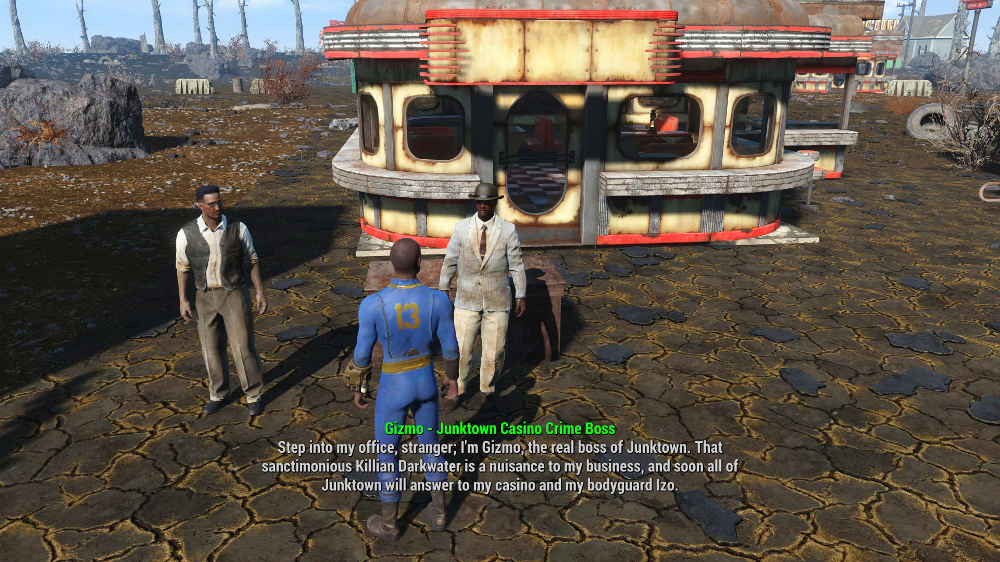
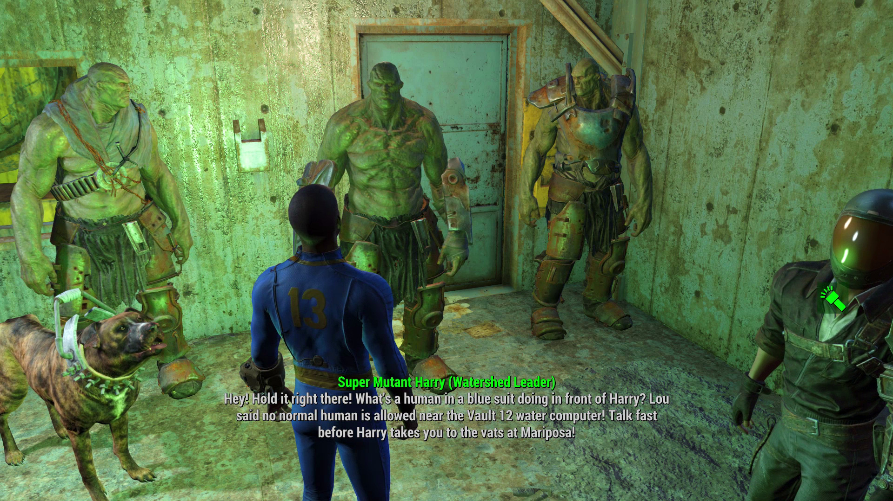
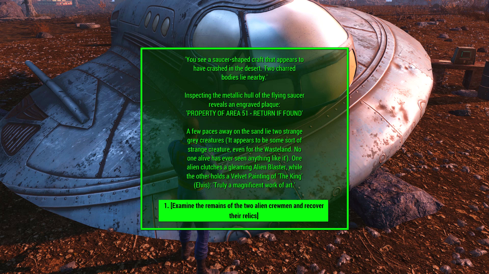
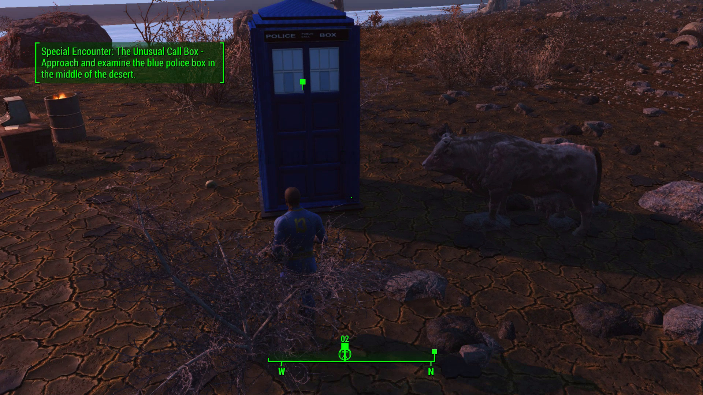
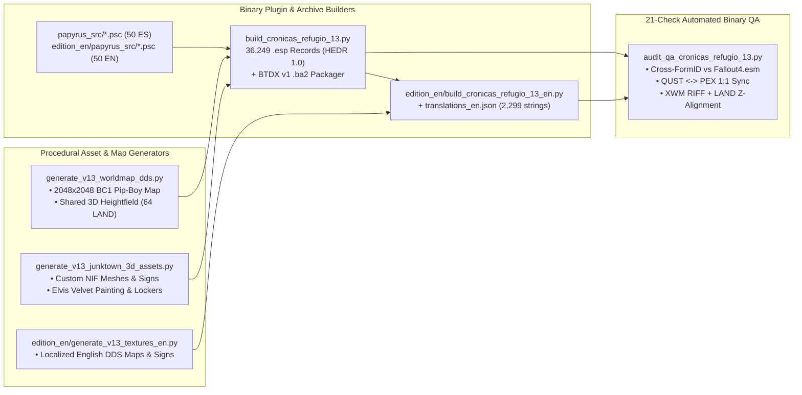
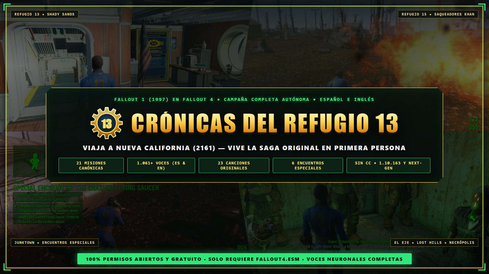

# Fallout 4 — Vault 13 Chronicles / Crónicas del Refugio 13 (2161)
### Standalone Recreation of *Fallout 1 (1997)* Inside Fallout 4 — Custom Southern California Worldspace, 1:1 Pip-Boy Map, Radio, Classic Companions & Multi-Path Quests (English & Spanish Editions)

[](LICENSE)
[](https://www.nexusmods.com/fallout4/mods/111327)
[](https://youtu.be/f4HKP1jbSHs)
[](#universal-compatibility)
[](#universal-compatibility)
[](ROADMAP.md)



> **🌍 Language Navigation & Direct Downloads / Navegación y Descarga Directa:**
> - 🎬 **[Watch Official Trailer on YouTube / Ver Tráiler Oficial en YouTube (`youtu.be/f4HKP1jbSHs`)](https://youtu.be/f4HKP1jbSHs)**
> - 🧡 **[Nexus Mods Unified Page (EN & ES Main Files — `#111327`)](https://www.nexusmods.com/fallout4/mods/111327)**
> - 🇺🇸 **[English Documentation (Features, Pip-Boy Worldspace, Status & Installation)](#english-documentation)**
> - 🇪🇸 **[Documentación en Español (Aportaciones Clave, Estado Actual, Hoja de Ruta e Instalación)](#documentación-en-español)**
> - 📦 **[Download Complete Playable `.zip` Packages (EN & ES) — GitHub Releases (`v0.9.0-beta`)](https://github.com/0utKast/fallout4-vault13-chronicles/releases/tag/v0.9.0-beta)**
>   - 🇺🇸 [`Vault13Chronicles_EN_v0.9.0_Beta.zip`](https://github.com/0utKast/fallout4-vault13-chronicles/releases/download/v0.9.0-beta/Vault13Chronicles_EN_v0.9.0_Beta.zip) *(100% Pure English Edition — Ready for Vortex / MO2 / Manual)*
>   - 🇪🇸 [`CronicasDelRefugio13_ES_v0.9.0_Beta.zip`](https://github.com/0utKast/fallout4-vault13-chronicles/releases/download/v0.9.0-beta/CronicasDelRefugio13_ES_v0.9.0_Beta.zip) *(Edición 100% en Español — Lista para Vortex / MO2 / Manual)*
> - 🗺️ **[Detailed Engineering Roadmap (`ROADMAP.md`)](ROADMAP.md)** · 📜 **[1997 Lore Bible (`CANON_FALLOUT_1_1997.md`)](CANON_FALLOUT_1_1997.md)** · ⚖️ **[Credits & Open Permissions (`CREDITS.md`)](CREDITS.md)**

---

<a name="english-documentation"></a>
# 🇺🇸 English Documentation

## 1. Overview
**Vault 13 Chronicles (2161)** is a **100% standalone, dependency-free recreation of Interplay's *Fallout: A Post Nuclear Role Playing Game (1997)* built directly inside the Fallout 4 engine**.

Discover the **Vault-Tec Mnemosyne Historical Archive** in the Commonwealth (northwest of Vault 111 / Sanctuary Hills) and step through the **Temporal Bridge** back to **December 5, 2161** as the original **Vault Dweller**—with just **150 days of water** remaining for Vault 13. Travel freely across a custom-engineered **Southern California open worldspace**, navigate directly on your **Pip-Boy 3000 tactical world map**, tune in to **The Hub Radio (84.5 kHz)**, recruit classic squad companions (**Ian**, **Desert Ranger Tycho**, and **Dogmeat**), resolve branching 1997 RPG quests through speech, stealth, bribery, science, or combat, and return to 2287 Commonwealth whenever you wish with every classic weapon and relic you unlock.

---

## 2. Key Technical & Gameplay Contributions

| Pillar | What Makes *Vault 13 Chronicles* Unique |
| :--- | :--- |
| 🗺️ **Custom Open Worldspace 100% Trackable on the Pip-Boy** | Hand-engineered **`8×8` exterior cell worldspace (`WRLD 0x01003400`, `64` `LAND` heightmap & vertex-normal cells, `32,768 × 32,768` units)** sculpting the Pacific coastline (Monterey to Santa Monica), Sierra Nevada passes, Central Valley, and Mojave wasteland (`36` flat `VHGT`-aligned plateaus so zero buildings float), paired 1:1 with a **custom `2048×2048` BC1 Pip-Boy World Map** (`23` discoverable `MapMarkers`, real-time player cursor, quest markers & fast travel). |
| 📻 **Dedicated 2161 Radio Station (*The Hub Radio 84.5 kHz*)** | Features **24 original atomic-age songs** interleaved with **24 voiced DJ news broadcasts** reacting to the events of 2161. Era-aware scripting (`V13RadioQuestScript.psc`) automatically tunes in upon entering 2161, suppresses anachronistic 2287 Commonwealth stations while in California, and restores your exact 2287 radio settings when you return! |
| 🤝 **Simultaneous Classic Squad Companions** | Recruit **Ian** (Shady Sands, Colt 6520 10mm Pistol), **Desert Ranger Tycho** (Junktown, Combat Shotgun & Ranger gear), and **Dogmeat 2161** (distinct Raider Dog breed & leather harness)—and **travel with all three simultaneously** across exterior wasteland and interior dungeons using dedicated tactical command menus. |
| 🎭 **True 1997 Multi-Path RPG Quest Design** | Every major quest honors *Fallout 1*'s non-linear philosophy: rescue **Tandi** in **4 distinct ways** (Speech/Intimidation—with dynamic reactivity if you already killed Garl in Vault 15—, 500-cap ransom, stealth lockpicking of the rear latch, or combat); trap **Gizmo** on tape in 3 ways; resolve **The Skulz**, **Doc Morbid's *Iguana Bob* secret**, **Water Merchants** (+100 days vs. Vault security risk), **Decker's Underground**, and **Necropolis Watershed** (bluffing **Harry, Barry & Sally** + repairing the Great Water Pump so Bakersfield's ghouls survive). |
| 🛸 **All 6 Classic 1997 Special Encounters (6/6)** | **1.** 1960s British Police Box (**TARDIS** + working **Pip-Boy Motion Sensor**!), **2.** Overturned **Nuka-Cola Truck** (`1000 + Luck × 976` caps), **3.** Area 51 **Crashed UFO** (**Alien Blaster** + custom 3D **Elvis Velvet Painting**), **4.** **Giant Godzilla Footprint** (**Stealth Boy 3001**), **5.** **Bob's Pre-Owned Car Mart** (**Red Ryder LE BB Gun**), and **6.** **Patrick the Celt** (voiced campfire encounter, Gaelic ballad *Na Fianna* & **+1 Permanent Charisma**). |
| 🎙️ **Two 100% Standalone Voiced Editions (EN + ES)** | Every single asset is localized natively in two separate builds: **`1,061` English** and **`1,020+` Spanish** `.xwm` voice lines across 9 voice types, localized `2048×2048` Pip-Boy maps, localized 3D world signs & quartermaster lockers, `43` 4-option dialogue wheels (`SCEN`), and `2,299` translated plugin subrecords. |
| 🛠️ **Programmatic Binary Compiler & 21-Check QA Suite** | Built reproducibly from Python (`build_cronicas_refugio_13.py`: `36,249` custom `.esp` records, `50` Papyrus `.psc`/`.pex` state machines, procedural `.nif`/`.dds` generators) and verified by `audit_qa_cronicas_refugio_13.py` (**`20/20` ES & `21/21` EN checks passed, `0` warnings, `0` errors**). |

### Custom `2048×2048` Calibrated Pip-Boy Tactical Maps (English & Spanish Editions)
| 🇺🇸 English Pip-Boy Tactical Map (`edition_en/`) | 🇪🇸 Spanish Pip-Boy Tactical Map (`assets/`) |
| :---: | :---: |
|  |  |

---

## 3. Clear Project Status: What Is Done (`v0.9.0`) vs. What Remains To Be Done (`v1.0`)

We believe in **100% engineering transparency** for players and fellow modders. Below is the exact breakdown of what is **100% completed, voiced, QA-verified, and playable right now in `v0.9.0 Public Beta (Chapter 1: The Water Chip)`** versus what is gated for **`v1.0 (Chapter 2: The Mutant Army & The Master)`**:

| Module / Region | Status | Details |
| :--- | :---: | :--- |
| **Prologue & Mnemosyne Temporal Bridge (`2287 ↔ 2161`)** | ✅ **100% Done** | Bunker NW of Vault 111, Memory Pod, Relic Hall & unrestricted two-way travel keeping all classic loot. |
| **Vault 13 Hub & Internal Subplots (`CELL 0x01002100`, `0x01002200`)** | ✅ **100% Done** | Overseer Jacoren, Lyle, Calvin, Cindy, Medical Officer, Scout Ed's corpse, Theresa's rebel faction & water theft investigation. |
| **Southern California Open Worldspace & Pip-Boy Map (`WRLD 0x01003400`)** | ✅ **100% Done** | `64` exterior `LAND` cells, `36` leveled plateaus, `23` `MapMarkers`, EN & ES `2048×2048` Pip-Boy maps, fast travel & quest markers. |
| **The Hub Radio (`84.5 kHz`)** | ✅ **100% Done** | `24` atomic-age tracks + `24` voiced DJ broadcasts (EN & ES) + automatic 2161/2287 radio switching. |
| **Shady Sands, Northern Khans & Act I: Vault 15 Ruins** | ✅ **100% Done** | Aradesh, Razlo's Radscorpion antidote for Jarvis, Diana & Gwen, **4-way Tandi Rescue**, Garl Death-Hand & Vault 15 rockslide holotape. |
| **Junktown (Killian, Gizmo, The Skulz & Doc Morbid)** | ✅ **100% Done** | Hitman Kenji, 3-way Gizmo taped confession, Neal's urn & Vinnie's Skulz, Doc Morbid's clinic & *Iguana Bob* cooler secret. |
| **The Hub (Irwin's Farm, Water Merchants, Caravans & Decker)** | ✅ **100% Done** | **.223 Pistol ("That Gun")**, Harold, Butch Harris, Martha Rastello's water caravan contract, Missing Caravans Deathclaw & Tug, Sheriff Greene vs. Decker & Kane. |
| **Act II: Necropolis, Underground, Watershed & Vault 12 Finale** | ✅ **100% Done** | Set & Garret, Underground ghouls & Ezekiel, Great Water Pump moral pact, Super Mutants **Harry, Barry & Sally** + Ghoul Prisoner, **Vault 12 Water Chip** extraction & Vault 13 restoration! |
| **Frontier Exterior Quests (Lost Hills Gate / The Glow & Boneyard)** | ✅ **100% Done** | Cabbot, Paladin Talus & Sgt. Allen's holodisk (**Wattz 2000 Laser Rifle**); Gabriel's Gun Runners, Smitty, Nicole & Deathclaw Mother nest. |
| **Classic Companions: *Ian*, *Ranger Tycho* & *Dogmeat 2161*** | ✅ **100% Done** | Simultaneous 3-companion squad travel with authentic loadouts and tactical command menus. |
| **All 6 Classic 1997 Special Encounters** | ✅ **100% Done** | TARDIS (+ Motion Sensor), Area 51 UFO (+ Alien Blaster & Elvis Painting), Nuka-Cola Truck, Giant Footprint, Bob's Car Mart (+ Red Ryder LE) & Patrick the Celt (+1 CHR). |
| **Act III Interior Expansion: Multi-Level Lost Hills & ZAX 1.2** | 🚧 **Pending (`v1.0`)** | Base interior cell (`0x01002B00`) & scripts exist (currently locked `LockLevel 253`). Pending full voiced trees for John Maxson, Rhombus, **Scribe Vree's Autopsy Holotape**, and **ZAX 1.2** inside The Glow. |
| **Classic Companion #4: *Katja* (Followers of the Apocalypse)** | 🚧 **Pending (`v1.0`)** | Adding recruitable companion **Katja** at the L.A. Boneyard Library alongside Nicole to complete the 4-companion roster. |
| **Act IV Expansion: Adytum Civil War & Mariposa Military Base** | 🚧 **Pending (`v1.0`)** | Base Mariposa cell (`0x01002C00`), **The Lieutenant**, & *Winchester P94* built (locked for Ch. 1). Pending Adytum Regulator/Blades conflict, robe disguise, forcefields & FEV Vats countdown. |
| **Act V Expansion: The Cathedral, The Master (3 Paths) & Exile Epilogue** | 🚧 **Pending (`v1.0`)** | Base Cathedral cell (`0x01002D00`), **Morpheus**, **The Master** & *Vindicator* built (locked for Ch. 1). Pending Psychic Nullifier, **3 canonical Master victory paths** (Vree's Autopsy proof, Combat, or 4-min Nuke) & **May 10, 2162 Exile Epilogue**. |

*(See [`ROADMAP.md`](ROADMAP.md) and [`INFORME_CAPITULO_1_HOJA_DE_RUTA.md`](INFORME_CAPITULO_1_HOJA_DE_RUTA.md) for FormID-level checklists).*

---

## 4. In-Game Screenshot Showcase (`1920×1080`)

| Vault 13 Overseer Jacoren Briefing | 4-Way RPG Choice: Rescuing Tandi |
| :---: | :---: |
|  |  |
| **Junktown: Confronting Crime Boss Gizmo & Izo** | **Necropolis Watershed: Super Mutant Harry** |
|  |  |
| **Special Encounter: Area 51 Crashed UFO & Elvis** | **Special Encounter: 1960s TARDIS & Motion Sensor** |
|  |  |

*(Browse all 20 full-resolution screenshots in [`NEXUS_MEDIA_PACK/02_20_CAPTURAS_GALERIA_1920x1080/`](NEXUS_MEDIA_PACK/02_20_CAPTURAS_GALERIA_1920x1080/)).*

---

<a name="universal-compatibility"></a>
## 5. Universal Compatibility & Open Modding Stance
- **Natively Compatible Out-of-the-Box With:**
  - **Fallout 4 `1.10.163`** *(Pre-Next-Gen / GOG / Downgraded)*
  - **Fallout 4 `1.10.980+`** *(Next-Gen / Anniversary Edition)*
- **Binary Engineering Standards:**
  - Plugin Header: **`HEDR v1.00`** with 100% of custom FormIDs allocated at `>= 0x01000800`.
  - Archives: **`BTDX Version 1`** (`GNRL v1` & `DX10 v1` — never `v7/v8`, so no backport patchers are needed on `1.10.163`).
- **Zero Lock-In:** Requires **only `Fallout4.esm`**. **Zero** Creation Club content, **zero** DLCs, **zero** F4SE/DLLs, and **zero** third-party mod dependencies. Released under **100% Open Permissions (MIT)**.

---

## 6. Installation & How to Start In-Game
1. **Download Your Preferred Standalone Edition** from **[Nexus Mods (`#111327`)](https://www.nexusmods.com/fallout4/mods/111327)** or **[GitHub Releases (`v0.9.0-beta`)](https://github.com/0utKast/fallout4-vault13-chronicles/releases/tag/v0.9.0-beta)**:
   - **English Edition:** `Vault13Chronicles_EN_v0.9.0_Beta.zip`
   - **Spanish Edition:** `CronicasDelRefugio13_ES_v0.9.0_Beta.zip`
2. **Install via Mod Manager or Manually:**
   - **Vortex / Mod Organizer 2 (Recommended):** Install the `.zip` archive directly and enable `Vault13Chronicles.esp`.
   - **Manual:** Extract `Vault13Chronicles.esp`, `Vault13Chronicles - Main.ba2`, and `Vault13Chronicles - Textures.ba2` into your `Fallout 4\Data` directory and enable `*Vault13Chronicles.esp`.
3. **Start Your Journey:**
   - Load any save (or start a new game). Your Pip-Boy automatically marks the **Vault-Tec Mnemosyne Historical Archive** bunker in the Commonwealth (northwest of Vault 111 / Sanctuary Hills).
   - Enter the bunker and activate the **Neural Simulation Mainframe** beside the Memory Pod to cross into **Vault 13 (December 5, 2161)**.

---

## 7. Architecture, Repository Layout & Reproducible Build Pipeline



### Repository Structure
- [`build_cronicas_refugio_13.py`](build_cronicas_refugio_13.py) — Primary binary `.esp` (`36,249` records) and `.ba2` (`v1`) compiler for the Spanish base build.
- [`generate_v13_worldmap_dds.py`](generate_v13_worldmap_dds.py) — Generates the `2048×2048` BC1 Pip-Boy tactical map and defines `global_california_height(wx, wy)` across all `64` exterior `LAND` cells.
- [`generate_v13_junktown_3d_assets.py`](generate_v13_junktown_3d_assets.py) & [`v13_opt_helpers.py`](v13_opt_helpers.py) — Procedural 3D `.nif` mesh, `.bgsm` material, and `BC1` mipmapped `.dds` texture generators.
- [`papyrus_src/`](papyrus_src/) & [`papyrus_out/`](papyrus_out/) — All `50` Papyrus quest, companion, radio, creature AI, weapon effect, and terminal state-machine scripts (`.psc` & compiled `.pex`).
- [`edition_en/`](edition_en/) — Complete standalone English localization pipeline (`translations_en.json`, `generate_v13_textures_en.py`, `sync_papyrus_en.py`, `synthesize_voices_and_radio_en.py`, `build_cronicas_refugio_13_en.py`, `papyrus_src/`, and `build_out/`).
- [`audit_qa_cronicas_refugio_13.py`](audit_qa_cronicas_refugio_13.py) & [`verify_v13_mod.py`](verify_v13_mod.py) — 6-module (`20/20` ES, `21/21` EN) binary integrity, quest/Papyrus sync, `.xwm` header, terrain Z-alignment, and `.ba2` asset chain audit suite.
- [`radio_music/`](radio_music/) — Original vintage atomic-age soundtrack tracks for *The Hub Radio / Radio El Eje (84.5 kHz)*.
- [`CANON_FALLOUT_1_1997.md`](CANON_FALLOUT_1_1997.md), [`ROADMAP.md`](ROADMAP.md), [`INFORME_CAPITULO_1_HOJA_DE_RUTA.md`](INFORME_CAPITULO_1_HOJA_DE_RUTA.md) — Historical 1997 canon bible and engineering roadmaps.
- [`NEXUS_MEDIA_PACK/`](NEXUS_MEDIA_PACK/) — Official banners (`1920×1080` & `1400×400`) and `20` full-HD gameplay screenshots.

### Running the Automated QA Suite
```powershell
# Audit Spanish build (20/20 checks)
python audit_qa_cronicas_refugio_13.py

# Audit English build including 2,299-string localization verification (21/21 checks)
python audit_qa_cronicas_refugio_13.py --en
```

---
---

<a name="documentación-en-español"></a>
# 🇪🇸 Documentación en Español



## 1. Descripción General
**Crónicas del Refugio 13 (2161)** es una **recreación autónoma y sin dependencias externas del mítico *Fallout: A Post Nuclear Role Playing Game (1997)* construida íntegramente dentro del motor de Fallout 4**.

Adéntrate en el **Archivo Histórico Mnemosyne de Vault-Tec** en la Commonwealth (al noroeste del Refugio 111 / Sanctuary Hills) y cruza el **Puente Temporal** hasta el **5 de diciembre de 2161** en la piel del **Morador del Refugio** original, cuando el Chip Controlador de Agua acaba de quemarse y solo quedan **150 días de reservas potables**. Recorre libremente un **mundo exterior de elaboración propia (Sur de California 2161)** perfectamente seguible desde el **mapa táctico de tu Pip-Boy**, sintoniza **Radio El Eje (84.5 kHz)**, viaja acompañado por un escuadrón clásico simultáneo (**Ian**, **el Ranger Tycho** y **Albóndiga**), resuelve misiones con múltiples vías al puro estilo RPG de 1997 (persuasión, soborno, sigilo/ganzúa, ciencia o combate) y regresa a la Commonwealth de 2287 cuando quieras conservando todas las armas y reliquias clásicas desbloqueadas.

---

## 2. Aportaciones Clave e Innovaciones Técnicas del Proyecto

1. **🗺️ Mundo Exterior Propio («Sur de California 2161») 100% Seguible desde el Pip-Boy (`WRLD 0x01003400`):**
   - **64 celdas exteriores de terreno `LAND` (`8×8`, `32.768 × 32.768` unidades)** esculpidas por código reproduciendo la costa del Pacífico californiano (desde Monterey/Big Sur hasta Santa Mónica/San Pedro), los pasos de Sierra Nevada, el Valle Central y el desierto del Mojave, con **36 mesetas de asentamiento niveladas matemáticamente** (`VHGT`) para que ningún edificio flote ni se entierre.
   - **Mapa Táctico `2048×2048` BC1 integrado en el Pip-Boy (`V13CaliforniaWorldMap_d.dds`)** proyectado 1:1 sobre las coordenadas reales del mundo (con ediciones dedicadas en español e inglés), **23 marcadores de mapa descubribles**, seguimiento de la posición del jugador en tiempo real, objetivos de misión y viaje rápido.
2. **📻 Emisora Propia de 2161 — *Radio El Eje / The Hub Radio (84.5 kHz)* (`V13RadioQuestScript.psc`):**
   - Incluye **24 canciones originales de estética años 40/50 de la era atómica** intercaladas con **24 boletines radiofónicos doblados** (en español en la edición ES y en inglés en la edición EN) que narran las noticias de Nueva California en 2161.
   - **Conmutación temporal inteligente:** Al cruzar a 2161 sintoniza la radio de Nueva California y silencia las emisoras anacrónicas de 2287 (Diamond City Radio, Radio Libertad, etc.), restaurando automáticamente tu configuración original al volver a la Commonwealth.
3. **🤝 Escuadrón de Compañeros Clásicos Simultáneos (*Ian*, *Ranger Tycho* y *Albóndiga 2161*):**
   - Recluta a **Ian** en Shady Sands (con su clásica **Colt 6520 de 10 mm**), al **Ranger del Desierto Tycho** en Junktown (con su **Escopeta de Combate** y armadura de Ranger) y a **Albóndiga 2161** (con su aspecto clásico de Perro de Presa y arnés de cuero con correas, distinto del Pastor Alemán de Fallout 4).
   - **Viaja con los tres a la vez** tanto por el desierto de California como por todos los interiores del mod, gestionándolos mediante menús tácticos propios.
4. **🎭 Diseño de Misiones Multi-Vía Fiel al RPG de 1997 y Reactividad Moral:**
   - **El Rescate de Tandi (`QUST 0x01018000`) por las 4 vías clásicas:** 1) Persuasión/Intimidación (con éxito inmediato y diálogo reactivo si ya eliminaste antes a Garl Mano Muerta en el Refugio 15), 2) Pago de rescate de 500 chapas (reembolsadas con creces por Aradesh), 3) Combate directo contra Petrox, o 4) Infiltración en sigilo forzando con horquilla el cerrojo trasero de su celda.
   - **Tramas profundas en cada ciudad:** Confesión grabada de **Gizmo** por 3 vías, **Neal y Los Cráneos (Vinnie)**, el oscuro secreto de **Doc Morbid** y *Bob's Iguana Bits*, la **Granja de Irwin** (**Pistola del .223 — «Esa Arma»**), el dilema estratégico de los **Mercaderes del Agua** (+100 días de agua frente al riesgo de revelar el Refugio 13), las **Caravanas Desaparecidas** (Sanguinario y el supermutante **Tug**), **Sheriff Greene frente a Decker y Kane**, y el **Dilema Hidrológico de Necrópolis** (reparar la Gran Bomba de Agua antes de llevarse el Chip del Refugio 12 y engañar, intimidar o abatir a los supermutantes **Harry, Barry y Sally**).
5. **🛸 Los 6 Encuentros Especiales Míticos de *Fallout 1* (6 de 6 Implementados):**
   - **Cabina Policial Británica TARDIS** (otorga un **Sensor de Movimiento** funcional para el Pip-Boy), **OVNI Estrellado del Área 51** (**Bláster Alienígena** + **Cuadro 3D en Terciopelo de Elvis «El Rey»**), **Camión de Nuka-Cola Volcado** (`1000 + Suerte × 976` chapas), **La Huella Gigante de Godzilla** (**RobCo Stealth Boy 3001**), **Concesionario de Coches de Bob** (**Red Ryder LE BB Gun**) y **Patrick el Celta** (rueda de diálogo doblada junto a la hoguera, balada gaélica *Na Fianna* y **+1 Carisma permanente**).
6. **🛠️ Ingeniería Binaria Reproducible, Doblaje Completo y Auditoría QA Automatizada:**
   - Dos ediciones autónomas 100% independientes (**Español** con `1.020+` audios `.xwm` e **Inglés** con `1.061` audios `.xwm`), `36.249` registros propios en `Vault13Chronicles.esp`, `50` scripts Papyrus compilados, `43` ruedas de diálogo interactivas (`SCEN`), modelos 3D `.nif` y texturas `BC1` propias, verificados al 100% por `audit_qa_cronicas_refugio_13.py` (**`20/20` checks ES y `21/21` checks EN superados con `0` advertencias y `0` errores**).

---

## 3. Lo Hecho (`v0.9.0`) y Lo Que Queda por Hacer (`v1.0`)

Para que cualquier jugador o desarrollador tenga claridad absoluta sobre el alcance actual y los siguientes pasos del proyecto:

### ✅ YA HECHO Y 100% JUGABLE EN `v0.9.0 Beta Pública` (*Capítulo 1: El Chip de Agua*)
- **Prólogo y Puente Temporal (`2287 ↔ 2161`)**: Búnker del Archivo Mnemosyne al noroeste del Refugio 111 con viaje libre de ida y vuelta y Sala de Reliquias.
- **Refugio 13 completo**: Supervisor Jacoren, residentes doblados, cueva de salida con el cadáver de Ed, rebelión interna de Theresa e investigación del robo de agua.
- **Mundo exterior «Sur de California (2161)» completo**: 64 celdas exteriores, mapa táctico `2048×2048` en el Pip-Boy (ES y EN), 23 ubicaciones con marcador y viaje rápido.
- **Radio El Eje (`84.5 kHz`) completa**: 24 canciones + 24 boletines doblados en español e inglés.
- **Actos I y II completos de principio a fin**: Shady Sands, Mutascorpiones, Campamentos de los Khans, Rescate de Tandi (4 vías), Ruinas del Refugio 15 (Garl Mano Muerta), Junktown (Killian, Kenji, Gizmo, Skulz, Doc Morbid), El Eje (Granja de Irwin, Harold, Butch Harris, Mercaderes del Agua, Caravanas Desaparecidas, Sheriff Greene vs. Decker), Necrópolis (Set, Subterráneos, Gran Bomba de Agua, Harry/Barry/Sally, Refugio 12) y restauración de la Planta Purificadora del Refugio 13.
- **Misiones exteriores de frontera ya jugables**: Exterior de Lost Hills y cráter de El Resplandor (**Cabbot**, **Paladín Talus** y el **Rifle Láser Wattz 2000**) + Exterior de El Boneyard (**Gabriel** y los Gun Runners, **Smitty**, **Nicole** y el nido de Sanguinarios).
- **3 Compañeros clásicos reclutables simultáneos**: **Ian**, **Ranger Tycho** y **Albóndiga (2161)**.
- **Los 6 Encuentros Especiales clásicos (6/6)** y **doble edición completa (ES + EN)** auditada con `0` errores.

### 🚧 QUEDA POR HACER PARA `v1.0` (*Capítulo 2: El Ejército Mutante y El Maestro*)
*(Los interiores base de `Lost Hills 0x01002B00`, `Base Militar Mariposa 0x01002C00` y `La Catedral 0x01002D00`, junto con sus jefes, armas finales `Winchester P94`, `Vindicator`, `Servoarmadura T-51f Endurecida` y scripts `V13Act3..5QuestScript`, ya están creados en el código y cerrados con cerrojo `LockLevel 253` durante el Capítulo 1 mientras completamos su expansión RPG profunda)*:
1. **Desbloqueo y Expansión del Acto III (Interior de Lost Hills e Interior de El Resplandor)**: Niveles interiores de la Hermandad del Acero (**John Maxson**, **Rhombus**, **Escriba Jefe Vree** con la **Holocinta de Autopsia de Supermutantes** y reparación de T-51b) + diálogo interactivo con la supercomputadora **ZAX 1.2** en West Tek.
2. **Cuarta Compañera Clásica — *Katja***: Incorporación de **Katja** en la Biblioteca de los Seguidores del Apocalipsis en El Boneyard para completar el cuarteto original (*Ian, Tycho, Katja y Albóndiga*).
3. **Desbloqueo y Expansión del Acto IV (Conflicto de Adytum y Base Militar Mariposa)**: Guerra civil entre los **Reguladores de Caleb** y **las Cuchillas de Razor** en Adytum (mejoras de **Smitty** y **Miles**) + infiltración multi-vía en **Mariposa** (disfraz de túnica de la Catedral, campos de fuerza, **El Teniente «Lou»** y autodestrucción de las Cubas de VEF).
4. **Desbloqueo y Expansión del Acto V (La Catedral, las 3 Vías frente al Maestro y Epílogo del Exilio)**: **Morpheus**, **Lasher**, el **Anulador Psíquico** de los prisioneros psíquicos, las **3 vías canónicas de victoria frente al Maestro** (1. Vía Diplomática/Científica con la Autopsia de Vree, 2. Victoria Militar, 3. Sabotaje de la ojiva nuclear con cuenta atrás de 4 minutos) y el **Epílogo jugable del Exilio (10 de mayo de 2162)** a las puertas del Refugio 13.

---

## 4. Compatibilidad Universal (`1.10.163` + Next-Gen/AE) e Instalación
- **Compatibilidad Nativa Universal:** Funciona directamente y sin parches tanto en **Fallout 4 `1.10.163` (Pre-Next-Gen / GOG / Downgraded)** como en **`1.10.980+` (Next-Gen / Anniversary Edition)** gracias a su cabecera **`HEDR v1.00`** (`FormIDs >= 0x800`) y archivos **`.ba2` Versión 1** (`GNRL v1` y `DX10 v1`).
- **Cero Dependencias y Política Abierta:** Solo requiere `Fallout4.esm` (**0** Creation Club, **0** DLCs, **0** F4SE y **0** mods externos). Publicado bajo **Permisos 100% Abiertos (Licencia MIT)**, rechazando cualquier sistema de bloqueo o privatización del *modding*.
- **Instalación Rápida:**
  1. Descarga la edición que prefieras desde **[Nexus Mods (`#111327`)](https://www.nexusmods.com/fallout4/mods/111327)** o desde **[GitHub Releases](https://github.com/0utKast/fallout4-vault13-chronicles/releases/tag/v0.9.0-beta)** ([`CronicasDelRefugio13_ES_v0.9.0_Beta.zip`](https://github.com/0utKast/fallout4-vault13-chronicles/releases/download/v0.9.0-beta/CronicasDelRefugio13_ES_v0.9.0_Beta.zip) en español o [`Vault13Chronicles_EN_v0.9.0_Beta.zip`](https://github.com/0utKast/fallout4-vault13-chronicles/releases/download/v0.9.0-beta/Vault13Chronicles_EN_v0.9.0_Beta.zip) en inglés) — y mira el **[Tráiler Oficial en YouTube](https://youtu.be/f4HKP1jbSHs)**.
  2. Instálalo con **Vortex / Mod Organizer 2** o extrae `Vault13Chronicles.esp`, `Vault13Chronicles - Main.ba2` y `Vault13Chronicles - Textures.ba2` en `Fallout 4\Data` y activa `Vault13Chronicles.esp`.
  3. Carga tu partida y dirígete al marcador del **Archivo Histórico Mnemosyne de Vault-Tec** (al noroeste del Refugio 111) para viajar al **Refugio 13 (5 de diciembre de 2161)**.

---

## 📜 Credits & License / Créditos y Licencia
- **Author / Autor:** **OutKast (`0utKast`)** — [GitHub Profile](https://github.com/0utKast)
- **License / Licencia:** **[MIT License & 100% Open Modding Permissions](LICENSE)** — Free to use, study, modify, translate, and redistribute with attribution. See **[`CREDITS.md`](CREDITS.md)** for complete acknowledgments to **Interplay Productions** (*Fallout*, 1997) and **Bethesda Game Studios** (*Fallout 4*).
